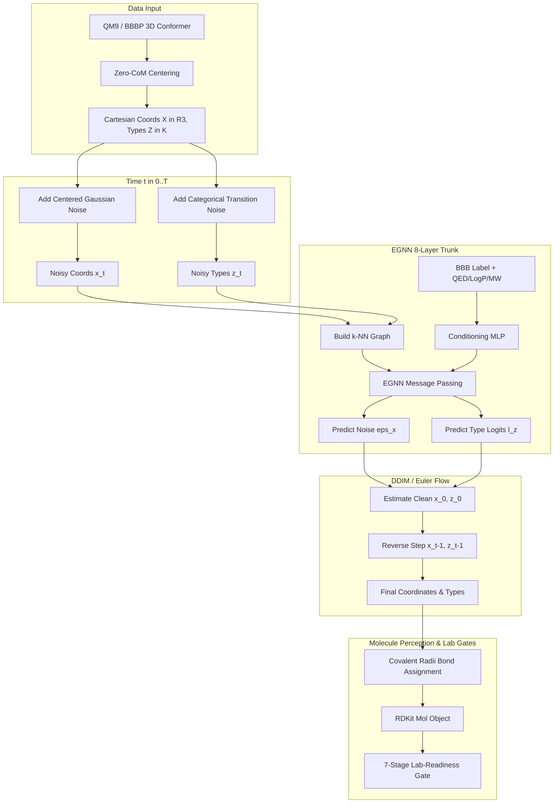

# 3D-Molecule-Diffusion: 3D Equivariant Graph Diffusion & Federated Learning

[](https://www.python.org/downloads/)
[](https://pytorch.org/)
[](https://flower.ai/)
[](https://www.rdkit.org/)

A research platform extending molecular generation from 2D graphs to **3D physical space**. This repository combines **$E(3)$-Equivariant Graph Neural Networks (EGNN)**, **Continuous 3D Cartesian Coordinate Diffusion (DDPM/DDIM)**, **Categorical Atom-Type Diffusion**, **Continuous Flow Matching**, **Classifier-Free Guidance (CFG)**, and **Federated Learning (FedAvg / FedProx)** for privacy-preserving drug design targeting Blood-Brain Barrier (BBB) permeability.

---

## Table of Contents

1. [High-Level Overview](#high-level-overview)
2. [The Core Mathematical Foundations (Explained Simply)](#the-core-mathematical-foundations-explained-simply)
   - [Part 1: Representing Molecules in 3D Space](#part-1-representing-molecules-in-3d-space)
   - [Part 2: Symmetry and Equivariance: Why $E(3)$ Matters](#part-2-symmetry-and-equivariance-why-e3-matters)
   - [Part 3: Equivariant Graph Neural Networks (EGNN)](#part-3-equivariant-graph-neural-networks-egnn)
   - [Part 4: 3D Coordinate Diffusion (DDPM & DDIM)](#part-4-3d-coordinate-diffusion-ddpm--ddim)
   - [Part 5: Categorical Diffusion for Atom Types](#part-5-categorical-diffusion-for-atom-types)
   - [Part 6: Continuous Flow Matching (Optimal Transport)](#part-6-continuous-flow-matching-optimal-transport)
   - [Part 7: Guided Molecular Design (Classifier-Free Guidance)](#part-7-guided-molecular-design-classifier-free-guidance)
   - [Part 8: Federated Learning Mechanics (FedAvg & FedProx)](#part-8-federated-learning-mechanics-fedavg--fedprox)
   - [Part 9: Multi-Objective Chemistry Losses ($\lambda_2, \lambda_3$)](#part-9-multi-objective-chemistry-losses-lambda_2-lambda_3)
3. [Architecture & Workflow Diagram](#architecture--workflow-diagram)
4. [Project Structure](#project-structure)
5. [Installation & Setup](#installation--setup)
6. [Usage Guide](#usage-guide)
   - [Centralized Training](#centralized-training)
   - [Generation & Evaluation](#generation--evaluation)
   - [Federated Training](#federated-training)
   - [Running the Test Suite](#running-the-test-suite)
7. [Benchmark Findings & Scientific Insights](#benchmark-findings--scientific-insights)
8. [References](#references)

---

## High-Level Overview

Traditional molecular generative models (like 2D graph GANs or SMILES language models) treat molecules as flat topological graphs or strings. However, biological target binding (e.g., crossing the blood-brain barrier or docking into an active site) depends strictly on **3D geometry**: bond angles, stereochemistry, interatomic distances, and molecular volume.

This codebase builds a complete 3D diffusion generative system:

* **Coordinates ($\mathbf{x} \in \mathbb{R}^3$)**: Diffused via continuous Gaussian noise projected onto the translation-invariant zero-center-of-mass subspace.
* **Atom Types ($z \in \{1, \dots, K\}$)**: Diffused simultaneously via categorical Markov chains.
* **Denoiser**: An $E(3)$-equivariant graph neural network that respects the laws of Euclidean physics.
* **Federation**: A Flower-compatible client/server system simulating distributed hospital or pharmaceutical silos training jointly without sharing proprietary molecular structures.

---

## The Core Mathematical Foundations (Explained Simply)

---

### Part 1: Representing Molecules in 3D Space

A molecule with $N$ atoms is represented as a geometric graph:

$$
\mathcal{M} = (\mathbf{X}, \mathbf{H})

$$

1. **Positions ($\mathbf{X} \in \mathbb{R}^{N \times 3}$)**: Continuous 3D Cartesian coordinates for each atom $i$:
   $$
   \mathbf{x}_i = [x_i, y_i, z_i]^\top \in \mathbb{R}^3

   $$
2. **Atom Features ($\mathbf{H} \in \mathbb{R}^{N \times K}$)**: One-hot encoded discrete element identities (e.g., Carbon, Nitrogen, Oxygen, Fluorine):
   $$
   \mathbf{h}_i \in \{0, 1\}^K

   $$

---

### Part 2: Symmetry and Equivariance: Why $E(3)$ Matters

#### The Intuition:

If you pick up a caffeine molecule and rotate it by $90^\circ$, or move it 2 inches to the left, **it is still caffeine**. Its internal chemical properties (mass, dipole moment, validity) do not change. Similarly, if atomic forces or noise displacements are predicted, those predicted vectors must rotate and shift by the exact same amount.

The Euclidean group $E(3)$ consists of all **rotations**, **translations**, and **reflections** in 3D space:

$$
g(\mathbf{x}) = \mathbf{R}\mathbf{x} + \mathbf{t}, \quad \text{where } \mathbf{R} \in O(3), \, \mathbf{t} \in \mathbb{R}^3

$$

#### Mathematical Definitions:

* **Invariance** (for scalar properties like energy or atom types):
  $$
  f(\mathbf{R}\mathbf{X} + \mathbf{t}) = f(\mathbf{X})

  $$
* **Equivariance** (for vector fields like coordinate noise predictions $\hat{\mathbf{\epsilon}}$):
  $$
  \mathbf{\Phi}(\mathbf{R}\mathbf{X} + \mathbf{t}) = \mathbf{R} \, \mathbf{\Phi}(\mathbf{X})

  $$

#### The Center-of-Mass (CoM) Projection:

Standard Gaussian noise randomly shifts the center of mass of the molecule, which causes unwanted translation drift. To eliminate translational degrees of freedom, the forward and reverse processes are restricted to the **zero-CoM subspace**:

$$
\mathbf{x}_i \leftarrow \mathbf{x}_i - \frac{1}{N} \sum_{j=1}^N \mathbf{x}_j

$$

Any noise vector $\mathbf{\epsilon} \sim \mathcal{N}(\mathbf{0}, \mathbf{I})$ is similarly centered:

$$
\mathbf{\epsilon}_i^{\text{centered}} = \mathbf{\epsilon}_i - \frac{1}{N} \sum_{j=1}^N \mathbf{\epsilon}_j

$$

---

### Part 3: Equivariant Graph Neural Networks (EGNN)

Standard graph neural networks take scalar edge weights. An **EGNN** (Satorras et al., 2021) operates on both scalar features $\mathbf{h}_i$ and spatial coordinates $\mathbf{x}_i$, guaranteeing $E(3)$-equivariance by construction.

For each layer $l$:

```
        Node i (x_i, h_i)               Node j (x_j, h_j)
               \                               /
                \                             /
                 ---> Distance: d_ij^2 = ||x_i - x_j||^2  (Invariant)
                 ---> Edge Message: m_ij = MLP([h_i, h_j, d_ij^2, t_emb])
                                |
               +----------------+----------------+
               |                                 |
               v                                 v
   Coordinate Displacement               Scalar Feature Aggregation
trans_ij = (x_i - x_j) * MLP_x(m_ij)     m_i = mean_j(m_ij)
x_i^(l+1) = x_i + sum_j trans_ij         h_i^(l+1) = h_i + MLP_h([h_i, m_i, t_emb])
(Equivariant Push/Pull)                  (Invariant In-place Update)
```

#### Step 1: Pairwise Invariant Distance

The squared distance between atoms $i$ and $j$ is invariant to any rotation or translation:

$$
d_{ij}^2 = \|\mathbf{x}_i - \mathbf{x}_j\|^2

$$

#### Step 2: Invariant Message Passing

Information is passed across edges using an MLP conditioned on node features, squared distance, and the diffusion timestep embedding $\mathbf{t}_{\text{emb}}$:

$$
\mathbf{m}_{ij} = \phi_e\left(\mathbf{h}_i^{(l)}, \mathbf{h}_i^{(l)}, d_{ij}^2, \mathbf{t}_{\text{emb}}\right)

$$

#### Step 3: Equivariant Coordinate Update (The "Spring" Analogy)

Atoms push or pull each other along the connecting line vector $(\mathbf{x}_i - \mathbf{x}_j)$. The network outputs a scalar magnitude $\phi_x(\mathbf{m}_{ij})$:

$$
\mathbf{x}_i^{(l+1)} = \mathbf{x}_i^{(l)} + \sum_{j \in \mathcal{N}(i)} (\mathbf{x}_i^{(l)} - \mathbf{x}_j^{(l)}) \, \phi_x(\mathbf{m}_{ij})

$$

*Notice*: If $\mathbf{X}$ is rotated by $\mathbf{R}$, every difference vector becomes $\mathbf{R}(\mathbf{x}_i - \mathbf{x}_j)$. The scalar $\phi_x(\mathbf{m}_{ij})$ does not change because $d_{ij}^2$ is invariant. Thus, the entire coordinate displacement rotates by $\mathbf{R}$!

#### Step 4: Invariant Feature Update

Scalar features are aggregated and updated:

$$
\mathbf{m}_i = \frac{1}{|\mathcal{N}(i)|} \sum_{j \in \mathcal{N}(i)} \mathbf{m}_{ij}

$$

$$
\mathbf{h}_i^{(l+1)} = \mathbf{h}_i^{(l)} + \phi_h\left(\mathbf{h}_i^{(l)}, \mathbf{m}_i, \mathbf{t}_{\text{emb}}\right)

$$

---

### Part 4: 3D Coordinate Diffusion (DDPM & DDIM)

#### The Forward Process (Destroying Structure with Noise):

We add a tiny amount of Gaussian noise at each timestep $t \in \{1, \dots, T\}$:

$$
q(\mathbf{x}_t \mid \mathbf{x}_{t-1}) = \mathcal{N}\left(\mathbf{x}_t; \, \sqrt{1 - \beta_t}\mathbf{x}_{t-1}, \, \beta_t \mathbf{I}\right)

$$

Using the reparameterization trick with $\alpha_t = 1 - \beta_t$ and $\bar{\alpha}_t = \prod_{s=1}^t \alpha_s$, any step $t$ can be sampled directly from the clean molecule $\mathbf{x}_0$:

$$
q(\mathbf{x}_t \mid \mathbf{x}_0) = \mathcal{N}\left(\mathbf{x}_t; \, \sqrt{\bar{\alpha}_t}\mathbf{x}_0, \, (1 - \bar{\alpha}_t)\mathbf{I}\right)

$$

$$
\mathbf{x}_t = \sqrt{\bar{\alpha}_t}\mathbf{x}_0 + \sqrt{1 - \bar{\alpha}_t}\mathbf{\epsilon}, \quad \mathbf{\epsilon} \sim \mathcal{N}(\mathbf{0}, \mathbf{I})

$$

#### The Cosine Noise Schedule:

Instead of a simple linear beta schedule (which destroys molecular geometry too early), we use the **cosine schedule** (Nichol & Dhariwal, 2021):

$$
\bar{\alpha}_t = \frac{f(t)}{f(0)}, \quad f(t) = \cos^2\left(\frac{t/T + s}{1 + s} \cdot \frac{\pi}{2}\right), \quad s = 0.008

$$

This preserves structural features at intermediate timesteps, giving the network time to learn subtle bond distances.

#### The Reverse Process (Denoising):

The neural network learns to predict the noise $\mathbf{\epsilon}$ that was added to $\mathbf{x}_0$:

$$
\mathcal{L}_{\text{pos}} = \mathbb{E}_{t, \mathbf{x}_0, \mathbf{\epsilon}} \left[ \|\mathbf{\epsilon} - \hat{\mathbf{\epsilon}}_\theta(\mathbf{x}_t, \mathbf{h}_t, t)\|^2 \right]

$$

#### Tweedie's Formula (Recovering the Clean Molecule):

From the model's noise prediction $\hat{\mathbf{\epsilon}}$, the denoised clean coordinates $\hat{\mathbf{x}}_0$ can be estimated at any point in time:

$$
\hat{\mathbf{x}}_0 = \frac{\mathbf{x}_t - \sqrt{1 - \bar{\alpha}_t}\hat{\mathbf{\epsilon}}_\theta}{\sqrt{\bar{\alpha}_t}}

$$

#### DDIM Fast Sampling (Denoising Diffusion Implicit Models):

Instead of 1,000 steps, **DDIM** allows sampling in 50–200 steps via a deterministic or controlled-stochastic ODE path:

$$
\mathbf{x}_{t-1} = \sqrt{\bar{\alpha}_{t-1}}\hat{\mathbf{x}}_0 + \sqrt{1 - \bar{\alpha}_{t-1} - \sigma_t^2} \, \hat{\mathbf{\epsilon}}_\theta + \sigma_t \mathbf{\epsilon}

$$

where:

$$
\sigma_t = \eta \cdot \sqrt{\frac{1 - \bar{\alpha}_{t-1}}{1 - \bar{\alpha}_t}} \sqrt{1 - \frac{\bar{\alpha}_t}{\bar{\alpha}_{t-1}}}

$$

* $\eta = 0.0$: Completely deterministic reverse sampling.
* $\eta = 1.0$: Standard stochastic Langevin ancestral sampling (adopted in this repo to prevent mode collapse).

---

### Part 5: Categorical Diffusion for Atom Types

You cannot add continuous Gaussian noise to discrete atom types (e.g. Carbon=6, Oxygen=8) without generating nonsensical fractional elements. We use **Categorical Diffusion** (EDM-style; Hoogeboom et al.):

#### The Forward Process:

Let $\mathbf{z}_0$ be the one-hot element vector of length $K$. At step $t$, the distribution interpolates between the true class and a uniform distribution over all $K$ elements:

$$
q(\mathbf{z}_t \mid \mathbf{z}_0) = \text{Categorical}\left( \bar{\alpha}_t \mathbf{z}_0 + (1 - \bar{\alpha}_t)\frac{\mathbf{1}}{K} \right)

$$

* At $t = 0$: The atom is 100% its true element ($\bar{\alpha}_0 \approx 1$).
* At $t = T$: The atom is pure uniform noise ($\bar{\alpha}_T \approx 0$).

#### The Reverse Step:

The EGNN outputs unnormalized logits $\hat{\mathbf{l}} \in \mathbb{R}^K$. Probabilities are recovered using the categorical posterior $q(\mathbf{z}_{t-1} \mid \mathbf{z}_t, \hat{\mathbf{z}}_0)$ derived via Bayes' theorem:

$$
q(\mathbf{z}_{t-1} \mid \mathbf{z}_t, \mathbf{z}_0) \propto q(\mathbf{z}_t \mid \mathbf{z}_{t-1}) \, q(\mathbf{z}_{t-1} \mid \mathbf{z}_0)

$$

We sample the atom type with temperature $T_{\text{type}}$:

$$
\mathbf{p} = \text{Softmax}\left(\frac{\hat{\mathbf{l}}}{T_{\text{type}}}\right)

$$

---

### Part 6: Continuous Flow Matching (Optimal Transport)

As an alternative to discrete diffusion, the repository includes **Continuous Flow Matching** (`diffusion.objective: flow`).

#### The Intuition:

Rather than taking a curved, stochastic Brownian path from noise to data, Flow Matching defines a **straight velocity vector field** connecting pure noise $\mathbf{\epsilon}$ directly to data $\mathbf{x}_0$.

```
Noise ε (t=1)  ----------------------------------> Clean x_0 (t=0)
                         Straight Line Path:
                  x_u = (1 - u)*x_0 + u*ε
                  Target Velocity: v = ε - x_0
```

#### The Math:

1. Interpolation along time $u \in [0, 1]$:
   $$
   \mathbf{x}_u = (1 - u)\mathbf{x}_0 + u\mathbf{\epsilon}

   $$
2. The exact velocity (derivative with respect to $u$):
   $$
   \mathbf{v}(\mathbf{x}_u, u) = \frac{d\mathbf{x}_u}{du} = \mathbf{\epsilon} - \mathbf{x}_0

   $$
3. Loss function: The model $\mathbf{v}_\theta$ learns to predict this velocity directly:
   $$
   \mathcal{L}_{\text{flow}} = \mathbb{E}_{u, \mathbf{x}_0, \mathbf{\epsilon}}\left[ \|\mathbf{v}_\theta(\mathbf{x}_u, u) - (\mathbf{\epsilon} - \mathbf{x}_0)\|^2 \right]

   $$
4. **Key Benefit**: Clean coordinates are recovered **linearly without division by $\sqrt{\bar{\alpha}_t}$**:
   $$
   \hat{\mathbf{x}}_0 = \mathbf{x}_u - u \, \hat{\mathbf{v}}_\theta

   $$

---

### Part 7: Guided Molecular Design (Classifier-Free Guidance)

To generate molecules that penetrate the Blood-Brain Barrier (BBB+), we steer the generation process using **Classifier-Free Guidance (CFG)** (Ho & Salimans, 2022).

#### Training with Label Dropout:

During training, the conditioning vector $\mathbf{c} = [\text{BBB\_label}, \text{QED}, \text{LogP}, \text{tPSA}, \text{MW}]$ is fed into the time embedding. With probability $p_{\text{uncond}} = 0.1$, $\mathbf{c}$ is dropped ($\mathbf{c} \leftarrow \emptyset$), forcing the network to learn both unconditional and conditional distributions.

#### Sampling with Guidance Scale $w$:

During inference, two forward evaluations are computed:

1. Conditional prediction: $\hat{\mathbf{\epsilon}}_{\text{cond}} = \hat{\mathbf{\epsilon}}_\theta(\mathbf{x}_t, t, \mathbf{c})$
2. Unconditional prediction: $\hat{\mathbf{\epsilon}}_{\text{uncond}} = \hat{\mathbf{\epsilon}}_\theta(\mathbf{x}_t, t, \emptyset)$

The guided score extrapolates along the property direction:

$$
\hat{\mathbf{\epsilon}}_{\text{guided}} = \hat{\mathbf{\epsilon}}_{\text{uncond}} + w \cdot \left(\hat{\mathbf{\epsilon}}_{\text{cond}} - \hat{\mathbf{\epsilon}}_{\text{uncond}}\right)

$$

$$
\hat{\mathbf{l}}_{\text{guided}} = \hat{\mathbf{l}}_{\text{uncond}} + w \cdot \left(\hat{\mathbf{l}}_{\text{cond}} - \hat{\mathbf{l}}_{\text{uncond}}\right)

$$

* At $w = 0$: Pure unconditional random generation.
* At $w = 1$: Standard conditional generation.
* At $w > 1$ (e.g., $w=4$): High-intensity steering toward the target property (lifts BBB+ success rate from 0% to 58.4%).

---

### Part 8: Federated Learning Mechanics (FedAvg & FedProx)

In drug discovery, different hospitals or pharmaceutical institutions hold private datasets they cannot share due to privacy or IP concerns. We simulate $K$ clients training a shared global model.

```
      +-------------------------------------------------+
      |             Central Server (FedAvg)             |
      |    w_global = sum_k (n_k / N) * w_k             |
      +-------------------------------------------------+
             ^                          |
             | Push weights             | Broadcast global
             |                          v
    +-----------------+        +-----------------+
    |    Client 1     |        |    Client 2     |
    | Formula split 1 |        | Formula split 2 |
    | Min: L_local    |        | Min: L_local    |
    |  + (μ/2)||w-w*|||        |  + (μ/2)||w-w*|||
    +-----------------+        +-----------------+
```

#### 1. Weighted FedAvg (McMahan et al., 2017)

At communication round $r$, client $k$ has $n_k$ molecules. The server aggregates client model parameters proportionally to their sample counts:

$$
\mathbf{w}_{\text{global}}^{(r+1)} = \sum_{k=1}^K \frac{n_k}{N} \, \mathbf{w}_k^{(r+1)}, \quad \text{where } N = \sum_{k=1}^K n_k

$$

#### 2. FedProx for Non-IID Heterogeneity (Li et al., 2020)

When different clients own drastically different molecular formulas (Non-IID), local gradients pull weights in conflicting directions. FedProx adds a **proximal penalty** that functions like an elastic rubber band holding local models close to the global consensus:

$$
\min_{\mathbf{w}} \, \mathcal{L}_k(\mathbf{w}) + \frac{\mu}{2} \|\mathbf{w} - \mathbf{w}_{\text{global}}^{(r)}\|^2

$$

* $\mu = 0$: Reduces to standard FedAvg.
* $\mu > 0$: Penalizes client drift, preventing divergence on specialized local splits.

#### 3. Personalized Heads (FedPer)

The $E(3)$-equivariant trunk (which learns universal 3D physical geometry) is aggregated globally, while final classification/bond heads can remain personalized to each local client.

---

### Part 9: Multi-Objective Chemistry Losses ($\lambda_2, \lambda_3$)

To discourage chemically impossible geometries during training, the loss function incorporates auxiliary physical penalties:

$$
\mathcal{L}_{\text{total}} = \mathcal{L}_{\text{pos}} + \lambda_{\text{type}}\mathcal{L}_{\text{type}} + \lambda_2 \mathcal{L}_{\text{valence}} + \lambda_3 \mathcal{L}_{\text{diversity}}

$$

#### 1. Differentiable Soft Valence Penalty ($\lambda_2$)

At low noise ($t < \tau$), we estimate clean coordinates $\hat{\mathbf{x}}_0$. The probability of an edge forming a covalent bond between atoms $i$ and $j$ is approximated by a smooth sigmoid with cutoff 1.8 Å:

$$
p_{ij} = \sigma\left(\frac{1.8 - \|\hat{\mathbf{x}}_{0, i} - \hat{\mathbf{x}}_{0, j}\|}{0.25}\right)

$$

The soft bond count of atom $i$ is compared to its maximum allowable valence $V_i$ (e.g., 4 for Carbon, 1 for Hydrogen):

$$
\mathcal{L}_{\text{valence}} = \sum_{i=1}^N \left( \text{ReLU}\left(1.2 \sum_{j \neq i} p_{ij} - V_i\right) \right)^2

$$

#### 2. Diversity Regularizer ($\lambda_3$)

To prevent the generator from collapsing into a single easy scaffold, batch-level uniqueness is encouraged by penalizing pairwise similarities between atom embedding representations:

$$
\mathcal{L}_{\text{diversity}} = \frac{1}{B(B-1)} \sum_{m \neq n} \cos\left(\bar{\mathbf{h}}_m, \bar{\mathbf{h}}_n\right)

$$

---

## Architecture & Workflow Diagram



---

## Project Structure

```text
3D-Molecule-Diffusion/
|-- configs/
|   |-- central.yaml             # Baseline QM9 centralized config
|   |-- central_v4_eps.yaml      # Winning QM9 V4 config (54.4% ConnV)
|   |-- central_v5_bbb.yaml      # BBBP conditioned diffusion recipe
|   |-- fed_iid.yaml             # Federated IID / FedAvg
|   `-- fed_niid.yaml            # Federated Non-IID / FedProx
|-- src/
|   |-- dataset.py               # QM9 loader and batched geometric graph helpers
|   |-- dataset_bbb.py           # BBBP/B3DB pipeline with MMFF 3D conformer generation
|   |-- sampling.py              # DDPM, DDIM, and Flow Euler reverse samplers
|   |-- objectives.py            # Valence penalty (λ2), diversity (λ3), Kabsch loss
|   |-- models/
|   |   |-- diffusion.py         # CenteredDDPM + Categorical TypeDDPM
|   |   |-- egnn.py              # Timestep & condition-aware EGNN denoiser
|   |   |-- flow.py              # Optimal Transport Flow Matching implementation
|   |   `-- bbb_classifier.py    # GCN Oracle for BBB permeability scoring
|   |-- fed/
|   |   |-- partition.py         # Formula-based IID / Non-IID partitioning
|   |   |-- trainer.py           # Local client training (FedProx, personal heads)
|   |   |-- client.py            # Flower NumPyClient interface
|   |   `-- server.py            # Aggregation server (FedAvg)
|   `-- utils/
|       |-- evaluation.py        # MOSES metrics + covalent-radii bond perceiver
|       |-- chem_qa.py           # Stereochemistry, bond strain, MMFF94 energy
|       |-- retrosynthesis.py    # 2-step template-based retrosynthesis feasibility
|       `-- lab_gate.py          # 7-stage composite Lab-Readiness Gate
|-- tests/                       # Complete unit test suite (350+ passing tests)
|-- generate_and_eval.py         # Generation and MOSES evaluation script
|-- train.py                     # Centralized training pipeline
|-- fed_train.py                 # Federated training pipeline
`-- progress.md                  # Comprehensive empirical lab notebook
```

---

## Installation & Setup

### Requirements:

* Python 3.10 or 3.11
* CUDA 11.8 or 12.1 (Optional, CPU execution supported for testing)
* RDKit, PyTorch, PyTorch Geometric, e3nn, Flower

### Setup Instructions:

```bash
# Clone the repository
git clone https://github.com/Myself-Praveen/3D-Molecule-Diffusion.git
cd 3D-Molecule-Diffusion

# Create a virtual environment
python -m venv .venv
source .venv/bin/activate  # On Windows: .venv\Scripts\activate

# Install PyTorch (select your CUDA version or CPU)
pip install torch --index-url https://download.pytorch.org/whl/cu121

# Install requirements
pip install -r requirements.txt

# Verify environment
python test_setup.py
```

---

## Usage Guide

### 1. Centralized Training

```bash
# Train baseline QM9 model
python train.py --config configs/central.yaml

# Train high-capacity V4-eps recipe
python train.py --config configs/central_v4_eps.yaml
```

Key training features:

* **Gradient Clipping**: Automatically set to 5.0 to prevent EGNN spikes.
* **Checkpoint Resumption**: Pass `--resume` to continue smoothly from `checkpoints/last.pt`.
* **EMA**: Exponential Moving Average stored in `best.pt`.

---

### 2. Generation & Evaluation

Generate 1,000 molecules using the calibrated DDIM-200 protocol:

```bash
python generate_and_eval.py \
  --checkpoint checkpoints/central_v4_eps/best.pt \
  --config configs/central_v4_eps.yaml \
  --num_samples 1000 \
  --ddim_steps 200 \
  --eta 1.0 \
  --step_schedule quadratic \
  --relax \
  --output_dir outputs/eval_v4_eps
```

To evaluate targeted BBB-permeable generation with Classifier-Free Guidance:

```bash
python generate_and_eval.py \
  --checkpoint checkpoints/central_v5_bbb/best.pt \
  --config configs/central_v5_bbb.yaml \
  --num_samples 1000 \
  --guidance_scale 4.0 \
  --target_bbb 1 \
  --bbb_oracle models/bbb_oracle.pt \
  --output_dir outputs/eval_guided
```

---

### 3. Federated Training

Simulate distributed training across multiple clients:

```bash
# IID Formula Split with FedAvg
python fed_train.py --config configs/fed_iid.yaml

# Non-IID Formula Split with FedProx (mu = 0.1)
python fed_train.py --config configs/fed_niid.yaml
```

---

### 4. Running the Test Suite

The test suite validates equivariance invariants, categorical posterior math, and chemical validity rules:

```bash
pytest tests/ -v
```

---

## Benchmark Findings & Scientific Insights

As documented in [`progress.md`](progress.md), our extensive empirical ablations produced several vital scientific discoveries:

1. **Proof of 3D Equivariant Diffusion on Small Molecules (QM9)**:
   * The **V4-eps** recipe achieved **54.4% Connected Validity**, 100% Uniqueness, 100% Novelty, and an Internal Diversity of **0.891** under the calibrated $\eta = 1.0$ quadratic DDIM sampler.
2. **Classifier-Free Guidance Successfully Controls Permeability**:
   * CFG successfully steered generated molecules from **0% BBB permeability ($w=0$) up to 58.4% ($w=4$)**, outperforming the unconditioned training set baseline (24.8%).
3. **The Limits of Cartesian Coordinate Diffusion on Flexible Drug Molecules**:
   * While small, rigid molecules (QM9, $\le 9$ heavy atoms) succeed, large flexible molecules (BBBP, $\sim 26$ atoms) suffer from **geometric over-connection (~32 bonds/mol vs ~19 real)** when trained with unconstrained Cartesian coordinate diffusion.
   * Exhaustive A/B testing proved this is **not** an undertraining issue (persisted across 200k steps), **not** a force-field relaxation issue, and **not** a bond-perception artifact.
   * **Takeaway**: For drug-sized flexible molecules, continuous Cartesian diffusion requires either explicit non-bonded steric repulsion forces during sampling or internal-coordinate (torsion/dihedral angle) diffusion.

---

## References

1. **GraphGANFed**: Manu, D., et al. *GraphGANFed: A Federated Generative Framework for Graph-Structured Molecules Towards Efficient Drug Discovery*. IEEE/ACM TCBB, 2024.
2. **EGNN**: Satorras, V. G., Hoogeboom, E., & Welling, M. *E(n) Equivariant Graph Neural Networks*. ICML, 2021.
3. **EDM**: Hoogeboom, E., Satorras, V. G., Vignac, C., & Welling, M. *Equivariant Diffusion for Molecule Generation in 3D*. ICML, 2022.
4. **DDPM**: Ho, J., Jain, A., & Abbeel, P. *Denoising Diffusion Probabilistic Models*. NeurIPS, 2020.
5. **DDIM**: Song, J., Meng, C., & Ermon, S. *Denoising Diffusion Implicit Models*. ICLR, 2021.
6. **Classifier-Free Guidance**: Ho, J. & Salimans, T. *Classifier-Free Diffusion Guidance*. NeurIPS Workshop, 2022.
7. **FedProx**: Li, T., Sahu, A. K., Zaheer, M., et al. *Federated Optimization in Heterogeneous Networks*. MLSys, 2020.

---

## License

This project is licensed under the MIT License - see the LICENSE file for details.
