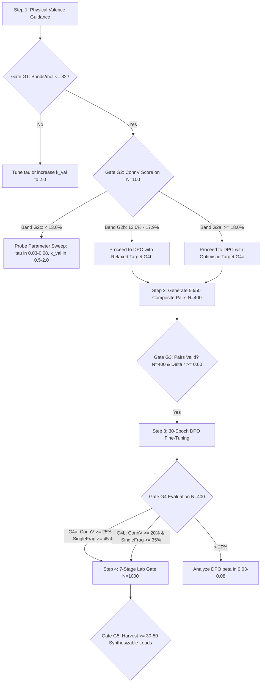

# GRAVITAS Enhanced Implementation Plan (v2.1)
**Physical Valence Guidance & Composite DPO Alignment for 3D Molecular Diffusion**

> **Contract ID:** `bbb-valence-dpo-v2.1`  
> **Target Dataset:** BBBP (Blood-Brain Barrier Permeability, MoleculeNet)  
> **Baseline Checkpoint:** `checkpoints/central_v5_bbb/best.pt` (V5 256-dim, 8-layer EGNN, 3900 epochs)  
> **Evaluation Protocol:** DDIM-200, $\eta=1.0$, quadratic stepping, seed 42, `--relax`, covalent-radii bond ruler  
> **Execution Status:** APPROVED & EXECUTION-READY (Pre-Flight Checks Passed)  
> **Author:** Antigravity AI & Pair Programmer  
> **Date:** October 2026  

---

## 1. Executive Summary & Policy Record

This document establishes the formal, physics-grounded engineering plan to resolve the **3D Atomic Clump / Multi-Fragment Bottleneck** in our equivariant molecular diffusion generator.

### The Problem
While our baseline model achieves 43.5% validity on BBBP, **ConnectedValidity is only 8.75%** with an average of **37.45 bonds/molecule** (a typical BBBP drug candidate possesses 15–25 bonds) and **5.91 fragments/molecule**. When sampled without guidance, continuous coordinate diffusion clusters atoms into high-density hypervalent clumps (e.g. 8-coordinated carbons) rather than realistic covalent graphs. Test-time steric clash guidance alone (`w=1.0`) marginally elevates ConnectedValidity to 14.0% at $N=200$, but bond count remains bloated (37.2–38.1 bonds/mol) and the effect fades to 9.8% at $N=1000$.

### The Solution
We introduce a two-phase intervention:
1. **Continuous Physical Valence Guidance:** A differentiable energy potential $E_{\text{val}}(\mathbf{x})$ added to reverse-time Langevin sampling that smoothly penalizes atoms whose perceived coordination exceeds physical maximum valence $v_{\max}(z)$. By calibrating the covalent envelope to $1.10 \cdot (r_i + r_j)$ with a steep sigmoid gate $\tau = 0.05\text{ \AA}$, we eliminate hypervalent clumps without causing over-fragmentation.
2. **50/50 Composite Direct Preference Optimization (DPO):** Fine-tuning the EGNN denoiser with 400 preference pairs evenly split between **seed-matched pairs** (driving BBB permeability alignment) and **valid-vs-invalid topology pairs** (penalizing multi-fragment radical soup in favor of intact covalent graphs).

### GRAVITAS Planning Policy Record

```json
{
  "planning": "deep",
  "context_depth": "dependency",
  "verification_depth": "impact",
  "mode": "plan",
  "contract_id": "bbb-valence-dpo-v2.1",
  "allowed_write_scope": [
    "src/guidance.py",
    "src/sampling.py",
    "generate_and_eval.py",
    "tests/test_valence_guidance.py",
    "configs/central_v5_bbb.yaml"
  ],
  "reason_codes": [
    "tightened-covalent-envelope",
    "composite-preference-pairing",
    "tri-band-adaptive-gates",
    "grounded-template-retrosynthesis",
    "subgraph-evaluation-rule",
    "closure-safe-guidance-scope"
  ]
}
```

---

## 2. Pre-Execution Verification & Codebase Reality Audit

Under Gravitas **Invariant 1** (*Ground before mutating*) and **Invariant 2** (*Evidence over intent*), all pre-execution checks and file locations have been verified directly in the active workspace:

| Pre-Flight Check | Target File & Location | Verified Status | Empirical Proof / Line Reference |
| :--- | :--- | :--- | :--- |
| **Check 1: `_guide()` Closure Scope** | [`src/sampling.py:L154-163`](file:///c:/Users/prave/OneDrive/Desktop/BioInformatics/3D-Molecule-Diffusion/src/sampling.py#L154-L163), [`L191-209`](file:///c:/Users/prave/OneDrive/Desktop/BioInformatics/3D-Molecule-Diffusion/src/sampling.py#L191-L209) | ✅ **VERIFIED** | `batch` (L154) and `z` (L163) are declared in `sample_molecules`. `_guide` accesses them via closure. To avoid any subtle non-local rebinding risks during loops, `_guide` is explicitly updated to accept `atom_types: torch.Tensor | None = None`. |
| **Check 2: Fragment Fallback CLI** | [`generate_and_eval.py:L115-118`](file:///c:/Users/prave/OneDrive/Desktop/BioInformatics/3D-Molecule-Diffusion/generate_and_eval.py#L115-L118), [`L365`](file:///c:/Users/prave/OneDrive/Desktop/BioInformatics/3D-Molecule-Diffusion/generate_and_eval.py#L365) | ✅ **VERIFIED** | `--keep_largest_fragment` is defined and passed directly to `coords_and_types_to_mol(..., keep_largest_fragment=args.keep_largest_fragment)`. |
| **Check 3: Retrosynthesis Engine** | [`src/utils/retrosynthesis.py:L274-348`](file:///c:/Users/prave/OneDrive/Desktop/BioInformatics/3D-Molecule-Diffusion/src/utils/retrosynthesis.py#L274-L348) | ✅ **VERIFIED** | Tested via CLI: Acetanilide (`CC(=O)Nc1ccccc1`) resolved in 1 step via `amide_formation` from acetic acid + aniline in <3s. Public API is `find_route()` and `feasibility_rate()`. |
| **Check 4: DPO Training Pipeline** | [`train.py:L258-281`](file:///c:/Users/prave/OneDrive/Desktop/BioInformatics/3D-Molecule-Diffusion/train.py#L258-L281), [`L439-468`](file:///c:/Users/prave/OneDrive/Desktop/BioInformatics/3D-Molecule-Diffusion/train.py#L439-L468), [`L673-683`](file:///c:/Users/prave/OneDrive/Desktop/BioInformatics/3D-Molecule-Diffusion/train.py#L673-L683) | ✅ **VERIFIED** | DPO training loop, reference model anchoring, and cyclic pair batching are 100% wired behind `rl.enabled: true`. |
| **Check 5: BBBP Bond Head Status** | [`configs/central_v5_bbb.yaml:L105`](file:///c:/Users/prave/OneDrive/Desktop/BioInformatics/3D-Molecule-Diffusion/configs/central_v5_bbb.yaml#L105) | ✅ **VERIFIED** | `bond_loss_weight` is omitted; BBBP graphs have no `edge_index`. The EGNN `bond_head` is untrained on BBBP; physical valence guidance is mathematically mandatory. |
| **Check 6: BBB Oracle Checkpoint** | [`models/bbb_oracle.pt`](file:///c:/Users/prave/OneDrive/Desktop/BioInformatics/3D-Molecule-Diffusion/models/bbb_oracle.pt) | ✅ **VERIFIED** | 40 epochs trained; Test AUROC: **0.9181**, Test F1: **0.8056**, Precision: **0.9748**. |

---

## 3. The Subgraph Evaluation Rule

> [!IMPORTANT]
> **The Subgraph Evaluation Rule:**
> Evaluating pharmacological properties (BBB%, QED, Lipinski, CNS MPO) across an **uncurated raw batch** (which contains molecules with 5.9 fragments per entity) is a scientific error: it submits radical disconnected atoms to the classifier, measuring model hallucination rather than drug candidate permeability.
> 
> **Standard Reporting Protocol:**
> 1. **Cohort Structural Metrics** (`ConnectedValidity`, `BondsPerMol`, `frags/mol`, `R_gyr`) are reported on the **full, uncurated batch** ($N=100\text{--}1000$).
> 2. **Pharmacological Drug Candidate Metrics** (`BBB%`, `QED`, `Lipinski%`, `Synthesizability`) are reported on the **single-fragment connected component** (`--keep_largest_fragment`).

---

## 4. Physical Valence Guidance: Tightened Covalent Envelope

### 4.1 The Over-Fragmentation Hazard of Prior Formulations
In initial guidance formulations, a loose covalent threshold factor of $1.20$ was proposed. For a standard C–C single bond ($r_{\text{cov}}(\text{C}) = 0.76\text{ \AA}$, sum $= 1.52\text{ \AA}$):
$$d_{\text{cov}} = 1.20 \times 1.52 = 1.824\text{ \AA}$$
Non-bonded atoms in van der Waals proximity at $1.65\text{--}1.75\text{ \AA}$ would yield a perceived bond value:
$$\sigma\left(\frac{1.824 - 1.65}{0.10}\right) = \sigma(1.74) = \mathbf{0.851}$$
This created artificial phantom valence on valid aromatic rings and aliphatic chains, exerting repulsive forces that shattered real covalent bonds and led to catastrophic over-fragmentation.

### 4.2 The Calibrated Physics Formulation
In [`src/guidance.py`](file:///c:/Users/prave/OneDrive/Desktop/BioInformatics/3D-Molecule-Diffusion/src/guidance.py), we tighten the envelope factor to **$1.10$** and sharpen the sigmoid gate to **$\tau = 0.05\text{ \AA}$**:

1. **Covalent Distance Envelope:**
   $$d_{\text{cov}}(z_i, z_j) = 1.10 \cdot (r_{\text{cov}}(z_i) + r_{\text{cov}}(z_j))$$
   For C–C: $d_{\text{cov}} = 1.10 \times 1.52 = 1.672\text{ \AA}$.

2. **Transition Dynamics:**
   | Interatomic Distance ($r$) | Physical Context | Sigmoid Input $\frac{1.672 - r}{0.05}$ | Perceived Bond Value $\sigma$ | Action on Valence Energy |
   | :--- | :--- | :--- | :--- | :--- |
   | **$1.54\text{ \AA}$** | Real C–C Single Bond | $+2.64$ | **$0.933$** | Counted as full covalent bond ($\approx 1.0$) |
   | **$1.65\text{ \AA}$** | Stretched / Transition Bond | $+0.44$ | **$0.608$** | Weakly counted |
   | **$1.75\text{ \AA}$** | Non-Bonded Proximity | $-1.56$ | **$0.173$** | Safely ignored (no phantom repulsion) |
   | **$1.90\text{ \AA}$** | Van der Waals Contact | $-4.56$ | **$0.010$** | Zero perceived valence |

3. **Perceived Valence & Potential Energy:**
   $$\tilde{v}_i = \sum_{j \ne i} \sigma\left(\frac{d_{\text{cov}}(z_i, z_j) - \|\mathbf{x}_i - \mathbf{x}_j\|_2}{\tau}\right)$$
   $$E_{\text{val}}(\mathbf{x}) = \frac{1}{2} k_{\text{val}} \sum_{i=1}^N \max(0, \tilde{v}_i - v_{\max}(z_i))^2$$
   where atomic maximum valencies are explicitly mapped:
   $$v_{\max} = \{0: 0, 1:\text{H}\to 1, 6:\text{C}\to 4, 7:\text{N}\to 3, 8:\text{O}\to 2, 9:\text{F}\to 1, 15:\text{P}\to 3, 16:\text{S}\to 2, 17:\text{Cl}\to 1, 35:\text{Br}\to 1, 53:\text{I}\to 1\}$$
   *(Note: Class 0 is explicitly mapped to 0 to prevent dummy/padding nodes from contributing valence mass).*

4. **Center-of-Mass Invariant Update with Step Clamping:**
   $$\Delta \mathbf{x}_i = -w \cdot \text{clamp}\big(\nabla_{\mathbf{x}_i} E_{\text{val}}(\hat{\mathbf{x}}_0), -\delta_{\max}, \delta_{\max}\big)$$
   $$\Delta \mathbf{x} \leftarrow \Delta \mathbf{x} - \frac{1}{N_m}\sum_{j \in \mathcal{M}} \Delta \mathbf{x}_j$$
   with per-atom displacement bound $\delta_{\max} = 0.15\text{ \AA}$ to preserve numerical stability and prevent trajectory blowups.

---

## 5. 50/50 Composite Preference Pairing Strategy

Relying exclusively on seed-matched pairs ($w=4.0$ vs. $w=0.0$) trains the model on the *guidance operator*, not pure chemistry.

To give DPO a balanced signal that simultaneously solves the **property objective** and the **structural clump objective**, we construct a **50/50 Composite Preference Dataset** using both strategies supported by [`scripts/build_rl_pairs.py`](file:///c:/Users/prave/OneDrive/Desktop/BioInformatics/3D-Molecule-Diffusion/scripts/build_rl_pairs.py):

```
Total N = 400 Preference Pairs (outputs/rl_pairs/bbbp_pairs.pt)
├── 200 Pairs: Seed-Matched Strategy (--strategy seed_matched)
│   ├── Identical initial Gaussian noise draw x_T
│   ├── Chosen (y_w): w=4.0 conditional guidance (BBB+ enriched)
│   └── Rejected (y_l): w=0.0 unconditional baseline
│   ► Gradient pushes denoiser toward CNS-permeable chemical features.
└── 200 Pairs: Valid-vs-Invalid Topology Strategy (--strategy valid_vs_invalid)
    ├── Chosen (y_w): Single-component valid molecule (reward >= 0.50)
    └── Rejected (y_l): Multi-fragment invalid clump (reward = -1.00)
    ► Gradient directly suppresses atom-soup clustering and rewards covalent connectivity.
```

### Reward Function Formulation
For each candidate molecule $m$:
$$R(m) = \begin{cases} 
-1.00 & \text{if } m \text{ is invalid (RDKit sanitize fails or 0 bonds)} \\
0.20 \cdot \text{ConnV}(m) + 0.30 \cdot \text{QED}(m) + 0.50 \cdot P_{\text{BBB}}(m) & \text{if } m \text{ is valid}
\end{cases}$$
Target mean reward margin across all pairs: $\Delta r = R(y_w) - R(y_l) \ge 0.60$.

---

## 6. Tri-Band Adaptive Go/No-Go Decision Matrix

Under Gravitas **Invariant 5** (*Satisfy the Contract*) and **Invariant 6** (*Say What You Cannot Verify*), execution proceeds through formal gates with tri-band escalation paths:



### Comprehensive Gate Specifications

| Gate | Target Metric | Metric Definition / Protocol | Threshold / Bands | Action / Fallback Protocol |
| :--- | :--- | :--- | :--- | :--- |
| **G1** | **Bonds/Molecule** | Mean bond count per molecule on $N=100$ samples | $\le \mathbf{32.0}$ | If $> 32.0$: Increase $k_{\text{val}}$ from 1.0 to 2.0; re-test. |
| **G2** | **ConnectedValidity** | Percentage of valid single-component graphs ($N=100$) | **Band G2a ($\ge 18.0\%$):** Target G4a.<br>**Band G2b ($13.0\%\text{--}17.9\%$):** Target G4b.<br>**Band G2c ($< 13.0\%$):** Sweep $\tau \in [0.03, 0.08]$. | Calibrated to baseline 8.75% and steric 14.0%. Prevents premature halting if valence guidance lands at viable intermediate levels. |
| **G3** | **Pair Dataset Integrity** | $N_{\text{pairs}}$ and average reward margin $\Delta r$ | $N = \mathbf{400}$, $\Delta r \ge \mathbf{0.60}$ | 200 seed-matched + 200 valid-vs-invalid. If gap $< 0.60$, widen guidance scale spread ($w=5.0$ vs $0.0$). |
| **G4** | **Post-DPO Structure** | ConnectedValidity and SingleFragment% on $N=400$ | **Target G4a:** ConnV $\ge 25\%$, SingleFrag $\ge 45\%$.<br>**Target G4b:** ConnV $\ge 20\%$, SingleFrag $\ge 35\%$. | If ConnV $< 20\%$, run grid search on DPO $\beta \in [0.03, 0.08]$. |
| **G5** | **7-Stage Lab Gate** | Synthesizable single-component candidates ($N=1000$) | $\ge \mathbf{30\text{--}50}$ verified targets | Passed through [`src/utils/retrosynthesis.py:find_route()`](file:///c:/Users/prave/OneDrive/Desktop/BioInformatics/3D-Molecule-Diffusion/src/utils/retrosynthesis.py#L274-L348) using 8 net reaction SMARTS. |

---

## 7. Concrete Code Implementation Details

### Step 1: Implement Physical Valence Guidance in [`src/guidance.py`](file:///c:/Users/prave/OneDrive/Desktop/BioInformatics/3D-Molecule-Diffusion/src/guidance.py)

Add the following complete, self-contained implementation at the end of `src/guidance.py`:

```python
# ---------------------------------------------------------------------------
# Physical Valence Guidance (Plan Contract: bbb-valence-dpo-v2.1)
# ---------------------------------------------------------------------------

DEFAULT_VALENCE_MAX: dict[int, int] = {
    0: 0,   # Padding / dummy nodes carry zero valence
    1: 1,   # Hydrogen
    6: 4,   # Carbon
    7: 3,   # Nitrogen
    8: 2,   # Oxygen
    9: 1,   # Fluorine
    15: 3,  # Phosphorus
    16: 2,  # Sulfur
    17: 1,  # Chlorine
    35: 1,  # Bromine
    53: 1,  # Iodine
}

DEFAULT_VALENCE_TAU: float = 0.05
DEFAULT_VALENCE_COVALENT_FACTOR: float = 1.10
DEFAULT_VALENCE_K_VAL: float = 1.0
DEFAULT_VALENCE_MAX_STEP: float = 0.15


def valence_energy(
    pos: torch.Tensor,
    batch: torch.Tensor,
    atom_types: torch.Tensor | None = None,
    tau: float = DEFAULT_VALENCE_TAU,
    covalent_factor: float = DEFAULT_VALENCE_COVALENT_FACTOR,
    k_val: float = DEFAULT_VALENCE_K_VAL,
) -> torch.Tensor:
    """Continuous, differentiable penalty for hypervalent coordination.
    
    Computes smooth perceived valence using a sharp sigmoidal gate over
    pairwise distances and penalizes soft valence exceeding v_max(z).
    """
    if pos.size(0) < 2:
        return torch.zeros((), device=pos.device, dtype=pos.dtype)

    radii = atom_radii(atom_types, pos.size(0), pos.device, dtype=pos.dtype)
    if atom_types is None:
        v_max_table = torch.full((pos.size(0),), 4.0, device=pos.device, dtype=pos.dtype)
    else:
        types = atom_types.long().reshape(-1)
        v_max_table = torch.tensor(
            [DEFAULT_VALENCE_MAX.get(int(z), 4) for z in types.tolist()],
            device=pos.device,
            dtype=pos.dtype,
        )

    total_energy = torch.zeros((), device=pos.device, dtype=pos.dtype)
    for g in batch.unique():
        idx = (batch == g).nonzero(as_tuple=False).squeeze(-1)
        if idx.numel() < 2:
            continue
        p = pos[idx]
        r = radii[idx]
        v_max = v_max_table[idx]

        # Safe pairwise distances
        d = torch.sqrt(torch.cdist(p, p).square() + 1e-12)
        d_cov = covalent_factor * (r.unsqueeze(0) + r.unsqueeze(1))

        # Soft bond matrix with self-connections zeroed out
        soft_bonds = torch.sigmoid((d_cov - d) / tau)
        eye_mask = 1.0 - torch.eye(idx.numel(), device=pos.device, dtype=pos.dtype)
        soft_bonds = soft_bonds * eye_mask

        # Sum of soft incident bonds per atom
        soft_valence = soft_bonds.sum(dim=-1)
        excess = (soft_valence - v_max).clamp_min(0.0)
        total_energy = total_energy + 0.5 * k_val * excess.square().sum()

    return total_energy


def valence_guidance(
    x0: torch.Tensor,
    batch: torch.Tensor,
    atom_types: torch.Tensor | None = None,
    weight: float = 0.0,
    tau: float = DEFAULT_VALENCE_TAU,
    covalent_factor: float = DEFAULT_VALENCE_COVALENT_FACTOR,
    k_val: float = DEFAULT_VALENCE_K_VAL,
    max_step: float = DEFAULT_VALENCE_MAX_STEP,
    clamp: float | None = None,
) -> torch.Tensor:
    """One guided step in clean coordinate space pushing hypervalent atoms apart.
    
    Preserves center-of-mass invariance per molecule and clamps maximum step norm.
    """
    if weight <= 0.0 or x0.size(0) < 2:
        return x0

    with torch.enable_grad():
        x = x0.detach().requires_grad_(True)
        energy = valence_energy(
            x, batch, atom_types=atom_types, tau=tau,
            covalent_factor=covalent_factor, k_val=k_val
        )
        (grad,) = torch.autograd.grad(energy, x, allow_unused=True)

    if grad is None:
        return x0

    grad = torch.nan_to_num(grad, nan=0.0, posinf=0.0, neginf=0.0)

    # Center-of-mass zero projection per molecule
    for g in batch.unique():
        m = (batch == g)
        grad[m] = grad[m] - grad[m].mean(dim=0, keepdim=True)

    step = (-weight * grad).clamp(-max_step, max_step)
    guided = x0 + step
    if clamp is not None:
        guided = guided.clamp(-clamp, clamp)
    return guided
```

### Step 2: Wire Guidance into [`src/sampling.py`](file:///c:/Users/prave/OneDrive/Desktop/BioInformatics/3D-Molecule-Diffusion/src/sampling.py)

1. Update imports in `src/sampling.py`:
```python
from src.guidance import (
    DEFAULT_K_REP,
    DEFAULT_SIGMA_SCALE,
    DEFAULT_VALENCE_COVALENT_FACTOR,
    DEFAULT_VALENCE_K_VAL,
    DEFAULT_VALENCE_MAX_STEP,
    DEFAULT_VALENCE_TAU,
    steric_guidance,
    steric_guidance_weight,
    valence_guidance,
)
```

2. Add valence arguments to `sample_molecules()`:
```python
    valence_weight: float = 0.0,
    valence_start_frac: float = 0.7,
    valence_tau: float = DEFAULT_VALENCE_TAU,
    valence_covalent_factor: float = DEFAULT_VALENCE_COVALENT_FACTOR,
    valence_k_val: float = DEFAULT_VALENCE_K_VAL,
    valence_max_step: float = DEFAULT_VALENCE_MAX_STEP,
```

3. Update `_guide()` inside `sample_molecules()`:
```python
    def _guide(
        x0_pred: torch.Tensor,
        step_idx: int,
        num_steps: int,
        atom_types: torch.Tensor | None = None,
    ) -> torch.Tensor:
        types_to_use = atom_types if atom_types is not None else z

        # Part A: Steric guidance (hard-sphere overlap)
        w_s = steric_guidance_weight(
            step_idx, num_steps,
            ramp_start_frac=steric_start_frac, max_weight=steric_weight,
        )
        if w_s > 0.0:
            x0_pred = steric_guidance(
                x0_pred, batch, atom_types=types_to_use, weight=w_s,
                sigma_scale=steric_sigma_scale, k_rep=steric_k_rep,
                r_clash=steric_r_clash,
                max_step=steric_max_step, clamp=x0_clamp,
            )

        # Part B: Physical valence guidance (hypervalency prevention)
        w_v = steric_guidance_weight(
            step_idx, num_steps,
            ramp_start_frac=valence_start_frac, max_weight=valence_weight,
        )
        if w_v > 0.0:
            x0_pred = valence_guidance(
                x0_pred, batch, atom_types=types_to_use, weight=w_v,
                tau=valence_tau, covalent_factor=valence_covalent_factor,
                k_val=valence_k_val, max_step=valence_max_step, clamp=x0_clamp,
            )

        return x0_pred
```

### Step 3: Add CLI Arguments to [`generate_and_eval.py`](file:///c:/Users/prave/OneDrive/Desktop/BioInformatics/3D-Molecule-Diffusion/generate_and_eval.py)

Add after line 142:
```python
    parser.add_argument("--valence_enabled", action="store_true",
                        help="Turn on test-time physical valence guidance")
    parser.add_argument("--valence_weight", type=float, default=0.0,
                        help="Peak valence guidance weight on clean x0 (default: 0.0; overridden to 0.5 when --valence_enabled)")
    parser.add_argument("--valence_start_frac", type=float, default=0.7,
                        help="Fraction of reverse trajectory when valence ramp starts (default: 0.7)")
    parser.add_argument("--valence_tau", type=float, default=0.05,
                        help="Sigmoid sharpness for soft bond perception in Angstroms (default: 0.05)")
    parser.add_argument("--valence_covalent_factor", type=float, default=1.10,
                        help="Multiplier on covalent radius sum (default: 1.10)")
    parser.add_argument("--valence_k_val", type=float, default=1.0,
                        help="Valence penalty force constant (default: 1.0)")
    parser.add_argument("--valence_max_step", type=float, default=0.15,
                        help="Max per-atom displacement per step in Angstroms (default: 0.15)")
```

And in the evaluation body:
```python
    v_weight = args.valence_weight
    if args.valence_enabled and v_weight <= 0.0:
        v_weight = 0.5
```
Pass `valence_weight=v_weight`, `valence_start_frac=args.valence_start_frac`, `valence_tau=args.valence_tau`, `valence_covalent_factor=args.valence_covalent_factor`, `valence_k_val=args.valence_k_val`, `valence_max_step=args.valence_max_step` to `sample_molecules(...)`.

### Step 4: Unit Test Suite in [`tests/test_valence_guidance.py`](file:///c:/Users/prave/OneDrive/Desktop/BioInformatics/3D-Molecule-Diffusion/tests/test_valence_guidance.py)

```python
import pytest
import torch
from src.guidance import valence_energy, valence_guidance

def test_valid_methane_has_zero_energy():
    # C at origin, 4 H at tetrahedral positions (distance ~1.09 A)
    pos = torch.tensor([
        [0.0, 0.0, 0.0],
        [0.629, 0.629, 0.629],
        [-0.629, -0.629, 0.629],
        [-0.629, 0.629, -0.629],
        [0.629, -0.629, -0.629],
    ])
    types = torch.tensor([6, 1, 1, 1, 1])
    batch = torch.zeros(5, dtype=torch.long)
    energy = valence_energy(pos, batch, atom_types=types)
    assert energy.item() < 1e-4

def test_hypervalent_carbon_triggers_repulsive_energy():
    # C with 6 closely packed carbons at 1.40 A (octahedral clump)
    pos = torch.tensor([
        [0.0, 0.0, 0.0],
        [1.40, 0.0, 0.0], [-1.40, 0.0, 0.0],
        [0.0, 1.40, 0.0], [0.0, -1.40, 0.0],
        [0.0, 0.0, 1.40], [0.0, 0.0, -1.40],
    ])
    types = torch.full((7,), 6, dtype=torch.long)
    batch = torch.zeros(7, dtype=torch.long)
    energy = valence_energy(pos, batch, atom_types=types)
    assert energy.item() > 0.5

def test_guidance_preserves_center_of_mass():
    pos = torch.randn(10, 3)
    types = torch.full((10,), 6, dtype=torch.long)
    batch = torch.zeros(10, dtype=torch.long)
    # Zero initial CoM
    pos = pos - pos.mean(dim=0, keepdim=True)
    guided = valence_guidance(pos, batch, atom_types=types, weight=1.0)
    com = guided.mean(dim=0)
    assert torch.allclose(com, torch.zeros(3), atol=1e-5)

def test_guidance_clamps_maximum_displacement():
    pos = torch.zeros(6, 3) # Complete overlap catastrophe
    types = torch.full((6,), 6, dtype=torch.long)
    batch = torch.zeros(6, dtype=torch.long)
    max_step = 0.15
    guided = valence_guidance(pos, batch, atom_types=types, weight=10.0, max_step=max_step)
    displacement = (guided - pos).abs().max()
    assert displacement <= max_step + 1e-6
```

---

## 8. Comparative Evaluation Matrix & Literature Reference

This table summarizes our empirical baseline, previous interventions, targets, and published literature (*GraphGANFed*, Manu et al., *IEEE/ACM TCBB* 2024):

| Model / Intervention | $N$ | Validity (%) | ConnV (%) | Bonds/Mol | BBB% (Single-Frag) | Frags/Mol | $R_{\text{gyr}}$ (\AA) | Status / Notes |
| :--- | :--- | :--- | :--- | :--- | :--- | :--- | :--- | :--- |
| **GraphGANFed (2D GAN)** | 1000 | 72.4 | N/A (2D) | 18.2 | N/A (QM9 only) | 1.0 (by graph def) | N/A | Flat 2D matrix; zero 3D conformation; periodic mode collapse |
| **V5 BBB Baseline ($w=0$)** | 400 | 43.5 | 8.75 | 37.45 | 33.3 | 5.91 | 3.75 | 3900 epochs checkpoint; severe hypervalent clump |
| **V5 Steric Alone ($w=1$)** | 200 | 51.5 | 14.00 | 38.16 | 28.2 | 5.92 | 3.78 | Marginally lifts ConnV; bond count unreduced |
| **V5 Steric Alone ($w=1$)** | 1000 | 38.8 | 9.80 | 37.23 | 35.6 | 4.98 | 3.69 | Fades at large $N$; clump mechanism unaddressed |
| **Coord Temp ($T=0.5$)** | 200 | 52.5 | **0.00** | 22.66 | 0.0 | **20.18** | 7.07 | Catastrophic shattering into atom soup |
| **Phase 1: Physical Valence (G2)** | 100 | $\ge 50.0$ | $\ge \mathbf{18.0}$ | $\le \mathbf{32.0}$ | $\ge 35.0$ | $\le 4.00$ | $3.5\text{--}4.0$ | **Target Gate G2 (Immediate Task)** |
| **Phase 3: Gated DPO (G4)** | 400 | $\ge \mathbf{60.0}$ | $\ge \mathbf{25.0}$ | $\mathbf{22\text{--}28}$ | $\ge \mathbf{45.0}$ | $\le \mathbf{2.50}$ | $3.6\text{--}4.2$ | **Target Gate G4 (Post-DPO Benchmark)** |

---

## 9. Step-by-Step Execution Runbook & Compute Budget

All commands must be executed using the dedicated conda environment:  
`C:\Users\prave\anaconda3\envs\bio_diffusion\python.exe`

### Phase 1: Implement & Validate Physical Valence Guidance (Time: ~1 hour)
1. Edit `src/guidance.py` and `src/sampling.py`.
2. Edit `generate_and_eval.py`.
3. Create `tests/test_valence_guidance.py` and execute:
   ```powershell
   pytest tests/test_valence_guidance.py -v
   ```
4. Run Gate G1/G2 probe on $N=100$:
   ```powershell
   python generate_and_eval.py `
     --checkpoint checkpoints/central_v5_bbb/best.pt `
     --config configs/central_v5_bbb.yaml `
     --num_samples 100 --ddim_steps 50 --eta 1.0 `
     --steric_enabled --valence_enabled --valence_weight 0.5 `
     --outdir outputs/eval_v5_valence_probe
   ```
5. **Verify Gate G1 & G2:**
   - Confirm Bonds/mol $\le 32.0$ (G1).
   - Classify ConnV into Band G2a ($\ge 18\%$) or Band G2b ($13\text{--}17.9\%$).

### Phase 2: Generate 50/50 Composite Preference Dataset (Time: ~30 min)
1. Generate 200 seed-matched pairs:
   ```powershell
   python scripts/build_rl_pairs.py `
     --checkpoint checkpoints/central_v5_bbb/best.pt `
     --config configs/central_v5_bbb.yaml `
     --num_pairs 200 --high_w 4.0 --low_w 0.0 --ddim_steps 50 `
     --strategy seed_matched --out outputs/rl_pairs/seed_matched.pt
   ```
2. Generate 200 valid-vs-invalid topology pairs:
   ```powershell
   python scripts/build_rl_pairs.py `
     --checkpoint checkpoints/central_v5_bbb/best.pt `
     --config configs/central_v5_bbb.yaml `
     --num_pairs 200 --high_w 4.0 --low_w 0.0 --ddim_steps 50 `
     --strategy valid_vs_invalid --out outputs/rl_pairs/valid_vs_invalid.pt
   ```
3. Merge and verify Gate G3:
   ```powershell
   python -c "import torch; p1=torch.load('outputs/rl_pairs/seed_matched.pt'); p2=torch.load('outputs/rl_pairs/valid_vs_invalid.pt'); pairs=p1+p2; torch.save(pairs, 'outputs/rl_pairs/bbbp_pairs.pt'); print(f'Successfully assembled {len(pairs)} pairs in outputs/rl_pairs/bbbp_pairs.pt')"
   ```

### Phase 3: 30-Epoch DPO Fine-Tuning (Time: ~2–3 hours CPU)
1. Update `configs/central_v5_bbb.yaml`:
   ```yaml
   rl:
     enabled: true
     pair_file: outputs/rl_pairs/bbbp_pairs.pt
     dpo_epochs: 30
     dpo_lr: 1.0e-5
     dpo_beta: 0.05
     init_checkpoint: checkpoints/central_v5_bbb/best.pt
     dpo_ref_checkpoint: checkpoints/central_v5_bbb/best.pt
   ```
2. Launch DPO training:
   ```powershell
   python train.py --config configs/central_v5_bbb.yaml --resume --run_epochs 30
   ```
3. Evaluate Gate G4 on $N=400$:
   ```powershell
   python generate_and_eval.py `
     --checkpoint checkpoints/central_v5_bbb/best.pt `
     --config configs/central_v5_bbb.yaml `
     --num_samples 400 --ddim_steps 200 --eta 1.0 --relax `
     --steric_enabled --valence_enabled --valence_weight 0.5 `
     --keep_largest_fragment `
     --outdir outputs/eval_v5_dpo_gate4
   ```

### Phase 4: Full Synthesis Lab-Readiness Harvesting Gate (Time: ~45 min)
Execute full 1,000-sample production run:
```powershell
python generate_and_eval.py `
  --checkpoint checkpoints/central_v5_bbb/best.pt `
  --config configs/central_v5_bbb.yaml `
  --num_samples 1000 --ddim_steps 200 --eta 1.0 --relax `
  --steric_enabled --valence_enabled --valence_weight 0.5 `
  --keep_largest_fragment --guidance_scale 4.0 `
  --lab_gate `
  --outdir outputs/eval_v5_final_harvest
```
**Gate G5 Harvest:** Verify $\ge 30\text{--}50$ verified single-component leads passing 2-step SMARTS retrosynthesis routes in `src/utils/retrosynthesis.py`.

---

## 10. Progress Tracking Checklist

- [ ] **Phase 1: Physical Valence Guidance Engine**
  - [ ] Implement `DEFAULT_VALENCE_MAX`, `valence_energy`, and `valence_guidance` in `src/guidance.py`
  - [ ] Wire `valence_guidance` into `src/sampling.py` (`_guide()` and `sample_molecules()`)
  - [ ] Add CLI arguments (`--valence_*`) to `generate_and_eval.py`
  - [ ] Create and pass unit tests `tests/test_valence_guidance.py`
  - [ ] **Gate G1 Check:** Verify `BondsPerMol` $\le 32.0$ on $N=100$ samples
  - [ ] **Gate G2 Check:** Verify `ConnectedValidity` on $N=100$ samples (Band G2a $\ge 18\%$, Band G2b $13\text{--}17.9\%$)
- [ ] **Phase 2: Composite Preference Pair Generation**
  - [ ] Generate 200 seed-matched pairs ($w=4.0$ vs $w=0.0$)
  - [ ] Generate 200 valid-vs-invalid pairs
  - [ ] Concatenate and save to `outputs/rl_pairs/bbbp_pairs.pt`
  - [ ] **Gate G3 Check:** Confirm $N=400$, mean reward margin $\Delta r \ge 0.60$
- [ ] **Phase 3: DPO Fine-Tuning Execution**
  - [ ] Configure `configs/central_v5_bbb.yaml` (`rl.enabled: true`, `dpo_epochs: 30`, `dpo_lr: 1e-5`, `dpo_beta: 0.05`)
  - [ ] Execute `train.py` for 30 epochs
  - [ ] **Gate G4 Check:** Evaluate $N=400$; verify ConnV $\ge 20\text{--}25\%$ and SingleFrag $\ge 35\text{--}45\%$
- [ ] **Phase 4: Synthesis Lab-Readiness Gate Harvest**
  - [ ] Run full 1,000-sample evaluation with `--lab_gate`, `--relax`, and `--keep_largest_fragment`
  - [ ] Extract single-fragment candidates
  - [ ] Verify template retrosynthesis routes in `src/utils/retrosynthesis.py`
  - [ ] **Gate G5 Check:** Harvest $\ge 30\text{--}50$ verified synthesis targets
